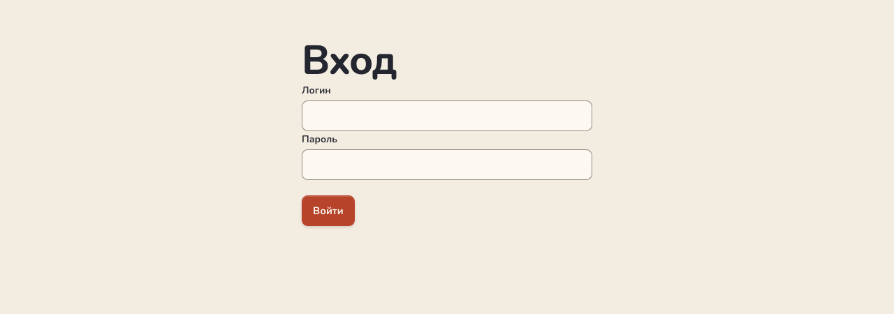
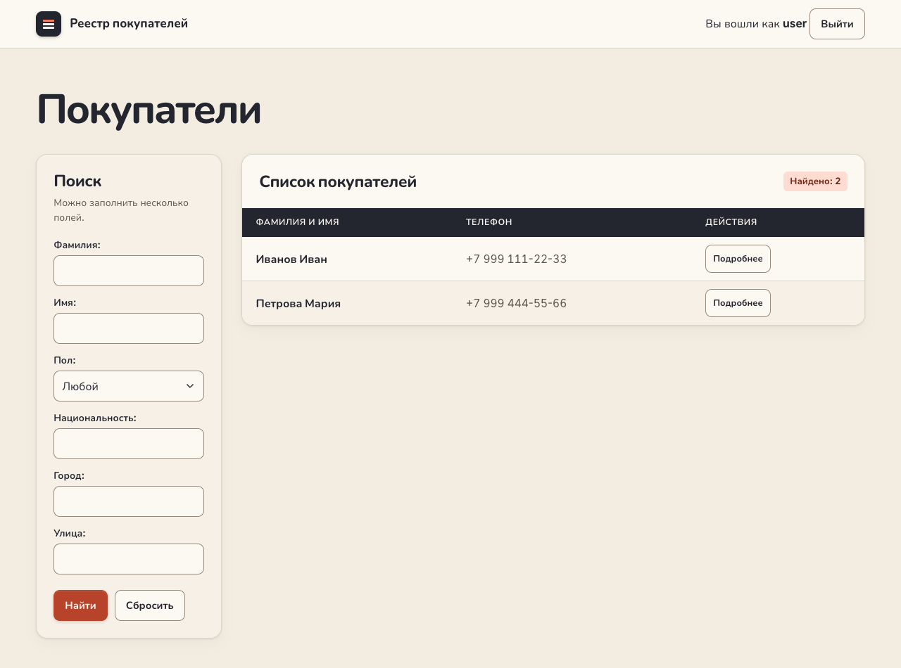
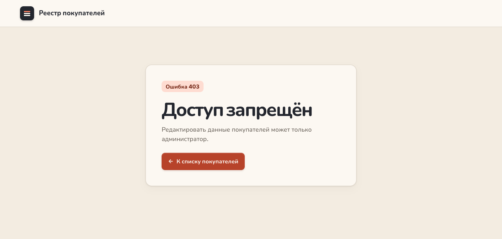
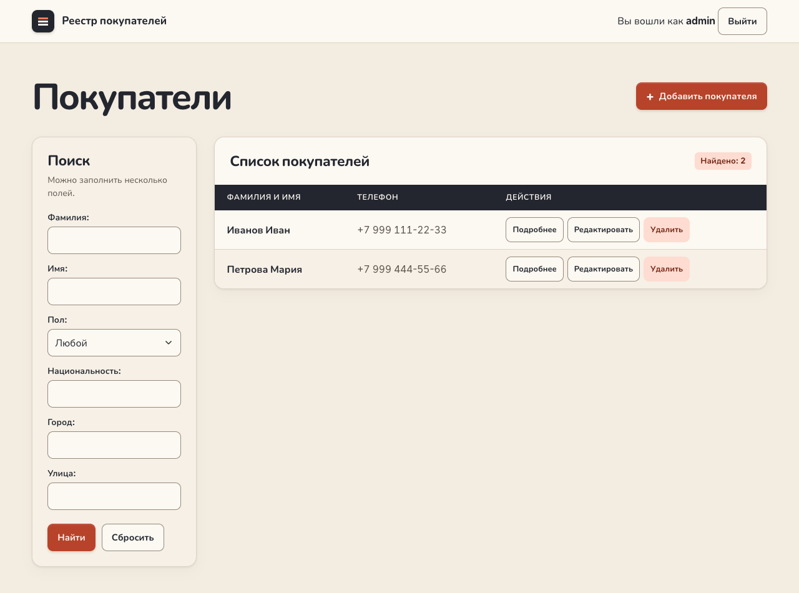
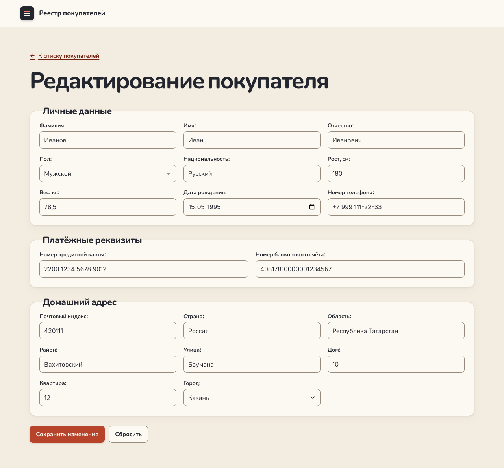

# Лабораторная работа №6 — Аутентификация пользователей

## Цель работы

Добавить в веб-приложение для работы с покупателями собственную форму входа на основе Spring Security. Хранить учётные записи в БД с BCrypt-хешами паролей и разграничить доступ по ролям.

## Архитектура проекта

- **Стек:** Java 21, Spring Boot 4.1.1, Gradle, Spring MVC, Spring Security, Spring Data JPA, Hibernate, Thymeleaf.
- **СУБД:** H2 в памяти. Hibernate создаёт таблицы, а `data.sql` заполняет их тестовыми данными при запуске.
- **Основные слои:**
  - **Controller.** `LoginController` показывает форму входа, `CustomerController` обрабатывает просмотр, поиск и изменение записей, `AccessDeniedController` отдаёт страницу ошибки со статусом `403`.
  - **Service.** `UserService` реализует `UserDetailsService` и загружает учётную запись для Spring Security.
  - **Repository.** `UserRepository.findByUsername()` ищет пользователя по логину. `CustomerRepository`, `AddressRepository` и `CityRepository` работают с данными реестра.
  - **Security.** `SecurityConfig` задаёт правила доступа, адреса входа и выхода, обработчик отказа в доступе и `BCryptPasswordEncoder`.
  - **Представления.** Шаблоны Thymeleaf отображают форму входа, список и карточку покупателя, формы добавления и редактирования и страницу `403`.
- **Ключевые аннотации:** `@Configuration`, `@EnableWebSecurity` и `@Bean` задают конфигурацию безопасности. `@Controller`, `@GetMapping`, `@PostMapping`, `@RequestMapping` и `@ResponseStatus` связывают HTTP-запросы с обработчиками. `@Service` регистрирует сервис пользователей. `@Entity`, `@Table` и `@Enumerated(EnumType.STRING)` описывают хранение учётных записей и ролей.
- **Модели данных и DTO.** `AppUser` соответствует таблице `users` и содержит идентификатор, уникальный логин, хеш пароля и роль из перечисления `Role`. `Customer` связан с `Address`, а `Address` с `City` отношениями `ManyToOne`. `CustomerFilter` передаёт критерии поиска из HTML-формы в контроллер. Формы создания и редактирования используют модель `Customer`.
- **Маппинг.** `UserService` вручную преобразует `AppUser` в объект `User` из Spring Security, передавая логин, хеш и полномочия.

## Алгоритм работы

1. Гость открывает `/customers`. Spring Security перенаправляет его на `/login`, где `LoginController` показывает форму Thymeleaf.
2. Форма отправляет `POST /login`. Spring Security вызывает `UserService`, загружает запись из H2 и сверяет введённый пароль с BCrypt-хешем. Для ручного получения хеша предусмотрен отдельный класс `PasswordHashGenerator`.
3. При успешном входе Spring Security сохраняет аутентификацию в HTTP-сессии и возвращает пользователя к запрошенной странице. Если пользователь открыл `/login` напрямую, после входа открывается `/customers`. При ошибке входа форма показывает сообщение о неверном логине или пароле.
4. `USER` и `ADMIN` могут просматривать список и карточки покупателей. Добавление, редактирование и удаление требуют роли `ADMIN`. Thymeleaf показывает соответствующие кнопки только администратору, а Spring Security проверяет роль на сервере.
5. Если `USER` открывает `/customers/update/{id}` напрямую, Spring Security передаёт запрос обработчику `/access-denied` через внутренний `forward`. Адрес в браузере остаётся прежним, а обработчик показывает шаблон `error/403.html` со статусом `403`.
6. Для POST-форм, включая удаление и выход, Thymeleaf добавляет CSRF-токен. Запрос `POST /logout` завершает сессию и перенаправляет на `/login?logout`.

### Запуск и тестовые учётные записи

Для запуска с JDK 21 выполни:

```bash
./gradlew bootRun
```

Открой `http://localhost:8080/customers`.

| Логин | Пароль | Роль | Доступ |
| --- | --- | --- | --- |
| `user` | `password` | `USER` | Просмотр и поиск покупателей |
| `admin` | `pass2` | `ADMIN` | Просмотр, поиск, добавление, редактирование и удаление |

## Скриншоты результатов тестирования

Сценарии проверены в Chrome на тестовых данных из `data.sql`.

### 1. Перенаправление гостя на форму входа

При открытии `/customers` без сессии браузер переходит на `/login`.



### 2. Список покупателей под ролью USER

После входа под `user` видны список, фильтры и кнопка просмотра карточки.



### 3. Отказ в доступе при прямом переходе к редактированию

Запрос `GET /customers/update/1` под `user` возвращает `HTTP 403` и показывает страницу «Доступ запрещён».



### 4. Список покупателей под ролью ADMIN

После входа под `admin` доступны кнопки добавления, редактирования и удаления.



### 5. Форма редактирования под ролью ADMIN

Тот же запрос `GET /customers/update/1` под `admin` возвращает `HTTP 200` и открывает форму покупателя.



